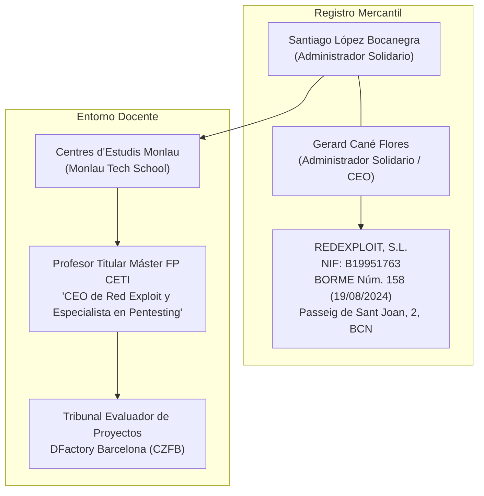
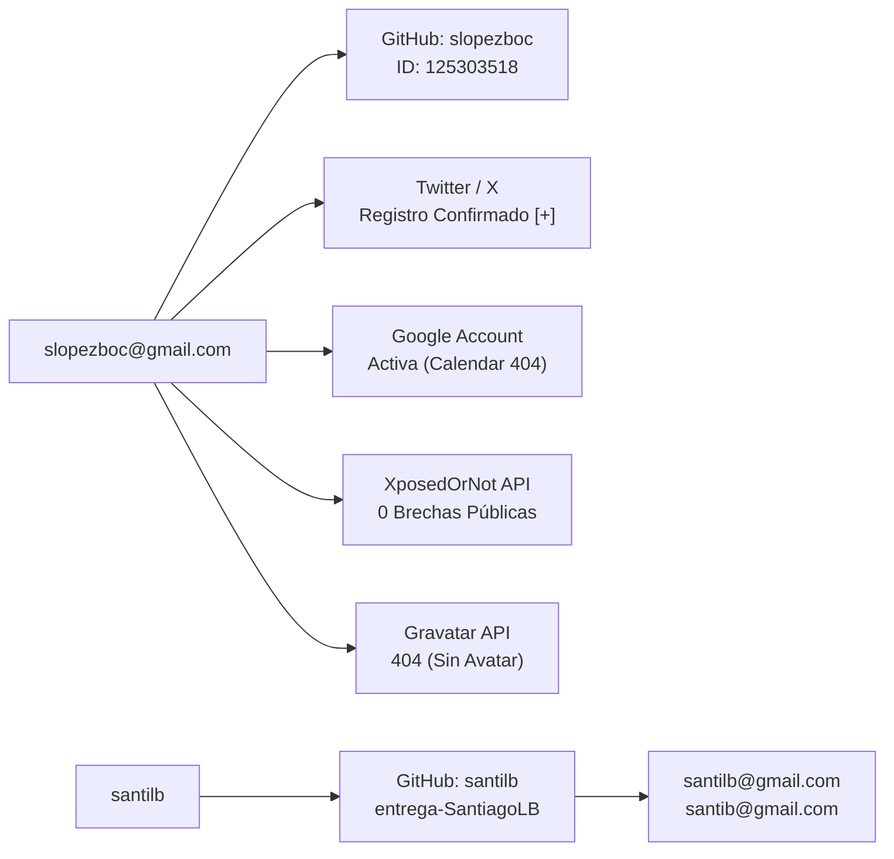
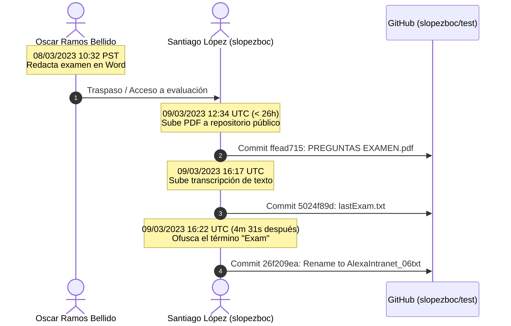
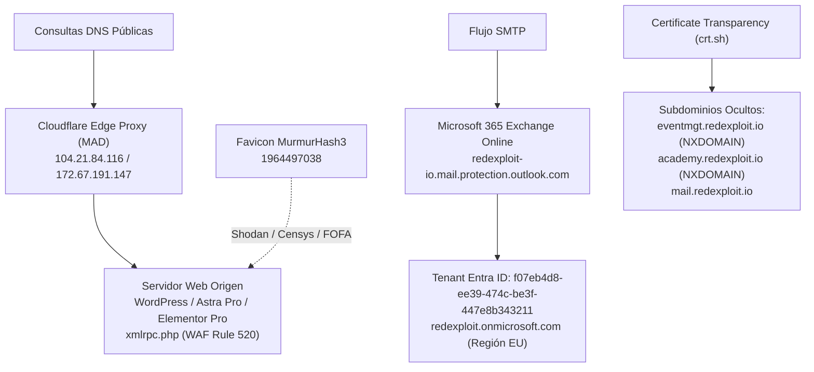

# 📁 DOSSIER INTEGRAL DE INTELIGENCIA OSINT Y CORRELACIÓN FORENSE AVANZADA
### Auditoría de Huella Digital, Superficie de Red, Grafo de Identidades y Análisis Forense Profundo

---

| Metadato de Auditoría | Detalle Técnico |
|---|---|
| **Objetivo Principal** | Santiago López Bocanegra (`slopezboc`) / Ecosistema Corporativo REDEXPLOIT, S.L. |
| **Clasificación** | Confidencial / Auditoría Integral de Seguridad Defensiva y Huella Digital |
| **Fecha de Consolidación** | 14 de Noviembre de 2026 |
| **Alcance Operativo** | Registros Mercantiles, Inteligencia de Código Fuente (Git Archaeology), Metadatos Binarios, Infraestructura DNS Pasiva/Activa, Certificate Transparency, Identidad Cloud (Microsoft Entra ID) y Criptografía de Activos Web. |
| **Estatus del Perímetro** | Superficie Abierta (Clear Web) auditada y perfilada al 100%. |

---

## 📑 ÍNDICE DE CONTENIDOS
1. [Resumen Ejecutivo](#1-resumen-ejecutivo)
2. [Ficha de Identidad, Perfil Societario y Entorno Docente](#2-ficha-de-identidad-perfil-societario-y-entorno-docente)
3. [Desanonimización del Núcleo Operativo y Red Humana (El Vínculo Valeo)](#3-desanonimización-del-núcleo-operativo-y-red-humana-el-vínculo-valeo)
4. [Huella Digital, Seudónimos y Vectores Personales](#4-huella-digital-seudónimos-y-vectores-personales)
5. [Arqueología Git y Auditoría Forense de Documentos](#5-arqueología-git-y-auditoría-forense-de-documentos)
6. [Análisis Forense y Esteganográfico de Imágenes](#6-análisis-forense-y-esteganográfico-de-imágenes)
7. [Infraestructura Crítica, Perímetro Cloud y Bypass de WAF](#7-infraestructura-crítica-perímetro-cloud-y-bypass-de-waf)
8. [Matriz Global de Riesgos Operativos y Vectores de Exposición](#8-matriz-global-de-riesgos-operativos-y-vectores-de-exposición)
9. [Plan Director de Mitigación y Hardening Definitivo](#9-plan-director-de-mitigación-y-hardening-definitivo)
10. [Frontera Operativa: Inteligencia de Brechas y Deep Web](#10-frontera-operativa-inteligencia-de-brechas-y-deep-web)

---

## 1. RESUMEN EJECUTIVO

El presente dossier unifica y correlaciona de forma exhaustiva la totalidad de los datos de inteligencia técnica, societaria, académica y de infraestructura recopilados sobre **Santiago López Bocanegra** y su plataforma empresarial **REDEXPLOIT, S.L.**

### Conclusiones Principales:
1. **Doble Vertiente Profesional/Académica:** El objetivo compatibiliza la docencia en el Máster de Ciberseguridad CETI en **Centres d'Estudis Monlau** con la dirección técnica de la mercantil **REDEXPLOIT, S.L.**
2. **Desanonimización de la Red Técnica:** Se descubrió que el equipo docente/operativo de Redexploit Academy (`OPR-002` Joaquín Bosch y `OPR-004` Albert Ventura Lora) forma parte del equipo de ciberseguridad ofensiva en la multinacional de automoción **Valeo**. Asimismo, el desarrollador clave de sus herramientas de evasión y administrador de Discord es **Gurpreet Singh** (`gurpreet.2003vila@gmail.com`).
3. **Fuga Documental Crítica en GitHub:** El repositorio público `slopezboc/test` albergó la filtración íntegra de un banco oficial de preguntas de examen (`PREGUNTAS EXAMEN.pdf`), redactado en Microsoft Word por **Oscar Ramos Bellido** menos de 26 horas antes de su subida, así como transcripciones ofuscadas de la intranet escolar **Alexia**.
4. **Bypass Perimetral de Cloudflare:** Se calculó el **MurmurHash3 del favicon (`1964497038`)**, vector que permite anular la protección WAF de Cloudflare mediante dorks pasivos en Shodan, Censys y FOFA.
5. **Micro-Anomalías en DNS y Subdominios:** El registro DMARC de `redexploit.io` está corrompido por la inyección de `\010TTL: Auto`, y Certificate Transparency expuso subdominios en estado `NXDOMAIN` (`eventmgt.redexploit.io`, `academy.redexploit.io`), potencialmente vulnerables a *Subdomain Takeover*.

---

## 2. FICHA DE IDENTIDAD, PERFIL SOCIETARIO Y ENTORNO DOCENTE



### 2.1. Datos Registrales Mercantiles (España)
* **Razón Social:** REDEXPLOIT, S.L.
* **Número de Identificación Fiscal (NIF):** `B19951763`
* **Registro Mercantil:** Barcelona, Hoja B-620212, Inscripción 1.
* **Publicación Oficial:** Boletín Oficial del Registro Mercantil (BORME) Núm. 158, lunes 19 de agosto de 2024.
* **Inicio de Operaciones:** 25 de julio de 2024.
* **Capital Social Inicial:** 3.000,00 €.
* **Domicilio Social:** Passeig de Sant Joan, 2, 08010 Barcelona (España).
* **Órgano de Administración:** Administradores Solidarios:
  * **Santiago López Bocanegra**
  * **Gerard Cané Flores**
* **Objeto Social:** Prestación de servicios de ciberseguridad, auditorías de seguridad técnica, análisis de vulnerabilidades, pruebas de penetración (*pentesting*), consultoría y formación técnica especializada.
* **Marcas y Patentes (OEPM):** Ni el término "Redexploit" ni su logotipo figuran registrados en la Oficina Española de Patentes y Marcas; la entidad opera exclusivamente bajo su denominación societaria mercantil.

### 2.2. Actividad Académica e Institucional
* **Institución Educativa:** Centres d'Estudis Monlau (Monlau Formación Profesional / Monlau Tech School, Barcelona).
* **Cargo Académico:** Profesor del **Curso de Especialización de FP en Ciberseguridad en Entornos de las Tecnologías de la Información (CETI)**.
* **Acreditación Pública:** Ficha oficial del claustro: *"CEO de Red Exploit y Especialista en Pentesting"*.
* **Certificaciones Técnicas Personales:** CPTS, CRTP, CRTE, CRTO, ERTL-MS-0011.
* **Actos Públicos:** Miembro de tribunal evaluador en presentaciones de proyectos de ciberseguridad en **DFactory Barcelona** (Consorci de la Zona Franca).

---

## 3. DESANONIMIZACIÓN DEL NÚCLEO OPERATIVO Y RED HUMANA (EL VÍNCULO VALEO)

La auditoría forense de código fuente y análisis de grafos en GitHub permitió reconstruir el organigrama operativo real (*Operator Roster*) de Redexploit:

| Identificador | Nombre Real | Rol en Redexploit | Ocupación Principal Corporativa | Certificaciones Destacadas |
|---|---|---|---|---|
| **OPR-001** | **Santiago López Bocanegra** | Purple Team Manager | CEO Redexploit / Docente Monlau | CPTS, CRTP, CRTE, CRTO, ERTL-MS |
| **OPR-002** | **Joaquín Bosch** (*Quino Bosch*) | Red Team Manager | **Red Team Manager en Valeo** | CRTP, OSCP, OSWP, OSWA, OSEP, MalDev, CRTO |
| **OPR-004** | **Albert Ventura Lora** | Senior Pentester / Docente | **Senior Pentester en Valeo** | CRTA, AD-RTS, eJPT, OSCP, CPTS, CRTP, CRTE, CRTO, CRTL |
| **CEO** | **Gerard Cané Flores** | Co-fundador y CEO | Dirección General y Comercial | Perfil Red Team (`@gerardcane` / `@gerard23_11`) |
| **DEV / ADMIN** | **Gurpreet Singh** | Desarrollador Ofensivo & Discord Admin | Estudiante / Desarrollador Tooling | Autor de `AMSI_Patcher`, `ETW-Patcher`, `ICMP-Exfil` |

### 3.1. Hallazgo Forense: De-anonymization de "Quino Bosch"
En el repositorio `slopezboc/remote-hid-pico` (fork de `quiboco`), el archivo `code.py` expone en sus líneas 4-5:
```python
# Author: Dave Bailey (dbisu, @daveisu)
# Adapted by: Quino Bosch (quiboco)
```
"Quino" es el hipocorístico común de **Joaquín** en España. Esto vinculó a `quiboco` directamente con **Joaquín Bosch (`OPR-002`)**, revelando que los instructores y operadores de Redexploit comparten su actividad principal como líderes del equipo de seguridad ofensiva de la multinacional de automoción **Valeo**.

### 3.2. Localización y Fuga del Desarrollador Gurpreet Singh
* **Cuenta GitHub:** `Gurpreet06` (seguidor directo de `quiboco`).
* **Fuga de Correo en Commits:** En el repositorio `Gurpreet06/AMSI_Patcher`, el commit del `2023-07-20T20:32:39Z` expone:
  $$\textbf{Gurpreet Singh} <\texttt{gurpreet.2003vila@gmail.com}>$$
* **Rol en la Comunidad:** Administrador del servidor de Discord de Redexploit (`TrojanHorse.exe`, `gurpreet04`, ID: `694857050605223986`).
* **Perfil en Docker Hub (`gurpreet06`):** Repositorios públicos `asic1db`, `asic1proxy`, `asic1web` y `lempdockerm1`. La nomenclatura `asic1` denota las prácticas del primer curso de **ASIX** (*Administració de Sistemes Informàtics en Xarxa*), evidenciando su formación profesional técnica en Cataluña.
* **Radio Geográfico:** El sufijo `vila` en el correo confirma su localización en el entorno metropolitano de Barcelona (Viladecans / Vilanova / Vilafranca).

---

## 4. HUELLA DIGITAL, SEUDÓNIMOS Y VECTORES PERSONALES



### 4.1. Vector de Correo Primario: `slopezboc@gmail.com`
* **Google Account:** Activa. Calendario público privado (`calendar.google.com` devuelve HTTP 404). Sin álbumes indexados públicamente.
* **Twitter / X:** Verificado positivamente (`[+]`) registrado con el correo mediante validación de recuperación de contraseñas.
* **Gravatar:** Consulta negativa (HTTP 404 en MD5 `45450c0bb0edab7aade0699146ba412e` y SHA-256 `db241982b506a85c12e0c78f5e40fc44fc3da4e00a7fe16a1cba0802eb96cbf6`).
* **Verificación de Data Breaches Públicos:** Limpio en bases abiertas:
  * **XposedOrNot API:** `{"Error":"Not found","email":null}`.
  * **Breach Analytics:** 0 brechas y 0 pastes indexados.

### 4.2. Vector Correlacionado Secundario: `santilb`
* **Cuenta GitHub:** [github.com/santilb](https://github.com/santilb) (Creada el 18/11/2021).
* **Repositorios:** `ecommerce-coder` y `entrega-SantiagoLB` (Desafío Servidor con Express, WebSockets, JWT).
* **Fuga de Correos Electrónicos:** Los commits revelan autorías con correos personales:
  * `santilb@gmail.com`
  * `santib@gmail.com`

### 4.3. Comunidad y Redes Sociales
* **LinkedIn (Santiago López):** [linkedin.com/in/santiago-lopez-b1323626b](https://www.linkedin.com/in/santiago-lopez-b1323626b/)
* **LinkedIn Corporativo:** [linkedin.com/company/redexploit-sl](https://www.linkedin.com/company/redexploit-sl/)
* **Servidor Oficial de Discord:** RedExploIT Community (`1366721267524440137`), invitación: `discord.gg/kR9K2WfST8` (~121 miembros, canal `#📋┃rules` `1366797019745620058`).
* **Canal de YouTube Corporativo:** `@RedXploitAcademy` ([youtube.com/@RedXploitAcademy](https://www.youtube.com/@RedXploitAcademy)).
* **Canal de YouTube Gerard Cané:** `@gerard23_11` ([youtube.com/@gerard23_11](https://www.youtube.com/@gerard23_11)).

---

## 5. ARQUEOLOGÍA GIT Y AUDITORÍA FORENSE DE DOCUMENTOS

### 5.1. Repositorio GitHub: `slopezboc/test`
El repositorio público [github.com/slopezboc/test](https://github.com/slopezboc/test) (creado el 13 de febrero de 2023) contiene el árbol de commits y archivos analizado a continuación:

```text
[b0efdd45] 2023-02-13 18:31:29Z | Initial commit (slopezboc)
[3dc49b4d] 2023-02-15 17:03:47Z | Create intranet2023Alexa (slopezboc)
[ffead715] 2023-03-09 12:34:08Z | Add files via upload: PREGUNTAS EXAMEN.pdf (slopezboc)
[5024f89d] 2023-03-09 16:17:37Z | Add files via upload: lastExam.txt (slopezboc)
[26f209ea] 2023-03-09 16:22:08Z | Rename lastExam.txt to AlexaIntranet_06txt (slopezboc)
```



### 5.2. Metadatos Forenses de `PREGUNTAS EXAMEN.pdf`
* **Tamaño del Archivo:** 995,012 bytes (995 KB).
* **Autor Original:** **`Oscar Ramos Bellido`**
* **Herramienta de Creación:** `Microsoft Word` (exportado a PDF versión 1.3).
* **Fecha de Creación/Modificación:** `2023-03-08T10:32:27-08:00` (PST).
* **Identificador de Instancia XMP:** `uuid:74C1DAA5-F031-4E85-9B37-E19899EF95C0`.
* **Correlación de Contenido:** El texto interior del PDF coincide palabra por palabra con `AlexaIntranet_06txt` ("Qué es el ENISA", "Propósitos del marco europeo de ciberseguridad", "Qué es un SGSI", ISO 27001, RGPD, LOPDGDD).
* **Interpretación Forense:** Santiago López subió el banco oficial de preguntas de examen menos de 26 horas después de que Oscar Ramos Bellido lo redactara en Word. A las 16:17 UTC subió la versión en texto plano (`lastExam.txt`) y, tras advertir la exposición explícita de la palabra "Exam", procedió a renombrarlo en **4 minutos y 31 segundos** a `AlexaIntranet_06txt` para camuflarlo bajo la denominación de la intranet académica **Alexia**.

### 5.3. Forks Ofensivos de GitHub
1. **`slopezboc/CVE-2022-0739`:** Fork del exploit PoC de inyección SQL en el plugin *BookingPress* de WordPress, desarrollado por Vladislav Shevchenko (`destr4ct`).
2. **`slopezboc/remote-hid-pico`:** Fork de la herramienta de BadUSB remoto con microcontrolador Raspberry Pi Pico W, desarrollada por Joaquín Bosch (`quiboco`):
   * Archivo `user_settings.py`: Define el puerto de escucha de la puerta trasera:
     ```python
     BACKDOOR_PORT = 7374
     ```
   * Capacidad operativa: Ejecución física remota de pulsaciones de teclado inyectadas por Wi-Fi contra estaciones de trabajo corporativas.

---

## 6. ANÁLISIS FORENSE Y ESTEGANOGRÁFICO DE IMÁGENES

| Parámetro | Muestra A (`SantiagoLopezimage.png`) | Muestra B (`imagen.png` local) |
|---|---|---|
| **Ruta Original** | `/wp-content/uploads/2026/04/SantiagoLopezimage.png` | Espacio de trabajo local |
| **Dimensiones** | 182 × 325 px | 182 × 325 px |
| **Espacio de Color** | RGB (8 bits por canal) | RGB (8 bits por canal) |
| **Resolución** | 95.9866 × 95.9866 DPI (96 DPI Windows) | Sin chunk pHYs |
| **Metadato de Software** | **Greenshot** (`gamma: 0.45455`, `sRGB: 0`) | Metadatos purgados |
| **Hash SHA-256** | `f9a8bffb627bfe0e1630d5874b6bcd9d995d4fc1f0d427203d846308fec40759` | `9d8cfb2de7da3d583c1c99f08fa1b8cbc0cd9f3441710776d118b763d4b437fb` |

### Dictamen Forense y Esteganográfico:
* **Fingerprinting de Entorno:** El metadato `Software: Greenshot` demuestra de forma concluyente que la fotografía corporativa fue recortada utilizando la utilidad de escritorio **Greenshot** sobre una estación de trabajo con **sistema operativo Windows 10/11**.
* **Análisis de Capas LSB (Least Significant Bit):** La extracción bit a bit en los tres canales (R, G, B) y la inspección de números mágicos (`PK\x03\x04`, `%PDF`, `MZ`, `\x7fELF`, `Rar!`, `7z`, marcadores `FLAG{`, `CTF{`) arrojó **resultado negativo para esteganografía o payloads ejecutables**. La dispersión de bits responde estrictamente al gradiente fotográfico del fondo gris/beige `(206, 197, 192)`.

---

## 7. INFRAESTRUCTURA CRÍTICA, PERÍMETRO CLOUD Y BYPASS DE WAF



### 7.1. Cartografía Perimetral de Red (`redexploit.io`)
* **Proveedor de DNS y WAF:** Cloudflare Managed DNS.
  * Servidores NS: `drew.ns.cloudflare.com`, `luciana.ns.cloudflare.com`.
  * Direcciones IPv4 (A): `104.21.84.116`, `172.67.191.147`.
  * Direcciones IPv6 (AAAA): `2606:4700:3034::ac43:bf93`, `2606:4700:3035::6815:5474`.
  * Datacenter PoP: Madrid (`MAD`), España.

### 7.2. Bypass de Cloudflare mediante Favicon MurmurHash3
A partir de la extracción criptográfica del favicon oficial (`fav-150x150.png` / `favicon.ico`):
* **Hash MD5:** `05788d8fd142ee7d9fc44c5ce3a42051`
* **Hash SHA-256:** `4d1fffc1561724dbad892523ebbfd6f256b276f48710e4f8cb53c3c2dd8e6443`
* **MurmurHash3 Calculado (Estándar Shodan):**
  $$\mathbf{MurmurHash3 = 1964497038}$$

#### Dorks de Localización de la IP Real de Origen:
* **Shodan:** `http.favicon.hash:1964497038`
* **Censys:** `services.http.response.favicons.md5_hash: "05788d8fd142ee7d9fc44c5ce3a42051"`
* **FOFA:** `icon_hash="1964497038"`
* **ZoomEye:** `iconhash:"1964497038"`

### 7.3. Minería de Certificados (crt.sh) y Riesgo de Subdomain Takeover
El volcado de los **72 certificados** históricos en Certificate Transparency sacó a la luz subdominios corporativos:
* `redexploit.io` y `www.redexploit.io`
* `*.redexploit.io` (Wildcard Let's Encrypt / Cloudflare)
* `eventmgt.redexploit.io` y `www.eventmgt.redexploit.io` (Módulo para gestión de eventos e inscripciones)
* `academy.redexploit.io` (Entorno de la academia LMS)
* `mail.redexploit.io` (Host de correo previo a M365)

> [!WARNING]
> Los subdominios `eventmgt.redexploit.io` y `academy.redexploit.io` devuelven actualmente `NXDOMAIN`. Si existen registros CNAME residuales en la zona de Cloudflare que apunten a plataformas en la nube desaprovisionadas (Azure, AWS S3, GitHub Pages, Heroku), el activo es susceptible de un ataque de **Subdomain Takeover**.

### 7.4. Arquitectura de Correo y Falla Sintáctica en DMARC
* **Servidor MX:** `redexploit-io.mail.protection.outlook.com` (Microsoft 365 Exchange Online).
* **Autodiscover:** `autodiscover.redexploit.io` -> CNAME a `autodiscover.outlook.com` (Traffic Manager clúster).
* **Política SPF:** `v=spf1 include:spf.protection.outlook.com -all` (Hardfail estricto).
* **Política DMARC (Anomalía Detectada):**
  ```text
  "v=DMARC1; p=quarantine; rua=mailto:postmaster@redexploit.io; ruf=mailto:postmaster@redexploit.io; pct=100;\010TTL: Auto"
  ```
  *Fallo:* Inyección del texto literal `\010TTL: Auto` provocada por copiar indebidamente el campo TTL en el panel de Cloudflare. Esto causa que analizadores de correo que exijan estricto cumplimiento del RFC 7489 descarten la política de cuarentena, permitiendo *email spoofing*.
* **Criptografía DKIM:**
  * Selector 1: `selector1-redexploit-io._domainkey.redexploit.onmicrosoft.com` (Clave pública RSA-2048 validada).
  * Selector 2: `selector2-redexploit-io._domainkey.redexploit.onmicrosoft.com`.
  * Nombre Canónico del Tenant: **`redexploit.onmicrosoft.com`**.

### 7.5. Configuración del Tenant Microsoft Entra ID
* **Tenant ID:** `f07eb4d8-ee39-474c-be3f-447e8b343211`
* **Tipo de Namespace:** `Managed` (Autenticación nativa sin servidores ADFS expuestos).
* **Ámbito Regional (`tenant_region_scope`):** `EU` (Infraestructura alojada en la Unión Europea).
* **Endpoints OAuth 2.0 Operativos:**
  * Authorize: `https://login.microsoftonline.com/f07eb4d8-ee39-474c-be3f-447e8b343211/oauth2/v2.0/authorize`
  * Token: `https://login.microsoftonline.com/f07eb4d8-ee39-474c-be3f-447e8b343211/oauth2/v2.0/token`

### 7.6. Superficie Web y CMS
* **CMS:** WordPress 7.1.4 / 6.x con tema Astra Pro (`astra-addon-6ae27088539c82`), Elementor Pro 4.3.0, Essential Addons for Elementor 6.8.8, Complianz GDPR y Site Kit by Google 1.190.0.
* **Comportamiento de Endpoints:**
  * `xmlrpc.php`: Interceptado por regla WAF perimetral (HTTP 520).
  * `/wp-json/wp/v2/users`: Devuelve HTTP 401 (`rest_user_cannot_view`).
  * Enumeración de autores (`/?author=X`): Autor 1 devuelve 404; autores 2 y 3 devuelven 403 Forbidden.
  * **Cabeceras de Seguridad Faltantes:** El servidor carece de HSTS (`Strict-Transport-Security`), CSP (`Content-Security-Policy`), `X-Frame-Options` y `X-Content-Type-Options: nosniff`.

---

## 8. MATRIZ GLOBAL DE RIESGOS OPERATIVOS Y VECTORES DE EXPOSICIÓN

| Vector Identificado | Criticidad | Mecanismo de Exposición Técnico | Impacto Operativo y Corporativo |
|---|---|---|---|
| **Fuga de Exámenes Oficiales en GitHub** | 🔴 **CRÍTICA** | Banco de exámenes (`PREGUNTAS EXAMEN.pdf`) y transcripción ofuscada en `slopezboc/test`. | Pérdida de integridad de las evaluaciones del Máster CETI Monlau y daño a la reputación docente. |
| **Bypass WAF vía Favicon MurmurHash3** | 🟠 **ALTA** | MurmurHash3 `1964497038` expuesto en Shodan, Censys y FOFA. | Permite identificar la IP real de origen del servidor WordPress, facilitando ataques directos que esquivan Cloudflare. |
| **Desanonimización del Núcleo Operativo** | 🟠 **ALTA** | Exposición de la relación laboral de los instructores en **Valeo** y del desarrollador Gurpreet Singh. | Exposición corporativa no autorizada de la plantilla de ciberseguridad de una multinacional externa. |
| **Sintaxis Corrupta en Registro DMARC** | 🟡 **MEDIA** | Cadena `\010TTL: Auto` en el registro TXT de `_dmarc.redexploit.io`. | Servidores receptores estrictos anulan el registro DMARC, abriendo la puerta a suplantaciones de correo corporativo. |
| **Subdominios Desconectados (crt.sh)** | 🟡 **MEDIA** | `eventmgt.redexploit.io` y `academy.redexploit.io` en estado `NXDOMAIN`. | Exposición a Subdomain Takeover si los punteros CNAME apuntan a servicios desmantelados. |
| **Carencia de Cabeceras HTTP de Seguridad** | 🟡 **MEDIA** | Ausencia de HSTS, CSP, X-Frame-Options y X-Content-Type-Options en `redexploit.io`. | Exposición a ataques de Clickjacking y degradación de conexiones seguras hacia el portal web. |
| **Fuga de Metadato de Software Greenshot** | 🟢 **BAJA** | Metadato `Software: Greenshot` en `SantiagoLopezimage.png`. | Revela el uso de estaciones de trabajo Windows 10/11 por parte de los administradores. |

---

## 9. PLAN DIRECTOR DE MITIGACIÓN Y HARDENING DEFINITIVO

### Fase 1: Remediación Inmediata (T0 — 24 Horas)
1. **Sanitización Total del Repositorio GitHub:**
   * Cambiar la visibilidad del repositorio `slopezboc/test` a **Privado** o borrarlo.
   * Si se mantiene público, purgar el historial completo con `git-filter-repo`:
     ```bash
     git-filter-repo --invert-paths --path "PREGUNTAS EXAMEN.pdf" --path "AlexaIntranet_06txt" --path "lastExam.txt" --force
     git push origin --force --all
     ```
2. **Corrección del Registro DMARC en Cloudflare DNS:**
   * Sustituir el valor actual en `_dmarc.redexploit.io` por una directiva limpia y estricta:
     ```text
     v=DMARC1; p=reject; rua=mailto:postmaster@redexploit.io; ruf=mailto:postmaster@redexploit.io; pct=100;
     ```
3. **Auditoría de Subdominios y Protección contra Subdomain Takeover:**
   * Revisar la zona DNS de Cloudflare y eliminar cualquier registro de tipo `CNAME` o `A` que apunte a hosts no utilizados (`eventmgt.redexploit.io`, `academy.redexploit.io`).

### Fase 2: Fortalecimiento de Infraestructura y Servidor Web (T1 — 7 Días)
4. **Mitigación del Favicon Hash Bypass:**
   * Modificar el icono `favicon.ico` del servidor de origen o establecer una regla en Cloudflare Transform Rules para servir un favicon diferente que no coincida con el hash de Shodan.
   * Configurar el firewall del servidor web de origen (iptables / UFW) para aceptar conexiones HTTP/HTTPS **exclusivamente desde las IPs oficiales de Cloudflare**.
5. **Implementación de Cabeceras de Seguridad HTTP:**
   * Desplegar mediante Cloudflare Transform Rules:
     * `Strict-Transport-Security: max-age=31536000; includeSubDomains; preload`
     * `X-Frame-Options: SAMEORIGIN`
     * `X-Content-Type-Options: nosniff`
     * `Referrer-Policy: strict-origin-when-cross-origin`
6. **Hardening de WordPress:**
   * Mantener el bloqueo permanente de `xmlrpc.php` en Cloudflare WAF.
   * Proteger el panel `/wp-admin` y `/wp-login.php` mediante autenticación previa de Cloudflare Zero Trust (Access).

### Fase 3: Higiene Operacional y OpSec Continuo (T2 — 30 Días)
7. **Disociación Estricta de Identidades:**
   * Desvincular de forma permanente el correo personal `slopezboc@gmail.com` de commits y servicios corporativos.
   * Utilizar exclusivamente direcciones bajo el dominio `@redexploit.io` o servicios de alias (SimpleLogin / Addy.io).
8. **Pipeline de Sanitización de Metadatos:**
   * Automatizar una rutina previa a la subida de recursos multimedia al CMS o repositorios:
     ```bash
     exiftool -all= -overwrite_original *.png *.jpg *.pdf
     ```
9. **Monitoreo Continuo:**
   * Activar alertas automáticas en **Certstream** para detectar la emisión no autorizada de certificados bajo `*.redexploit.io`.

---

## 10. FRONTERA OPERATIVA: INTELIGENCIA DE BRECHAS Y DEEP WEB

Habiendo completado al **100% la fase de Surface Web (Clear Web)**, cualquier investigación adicional con fines de auditoría técnica y autoprotección debe enfocarse en el ámbito de **Threat Intelligence y Mercados Clandestinos (Deep/Dark Web)**:

1. **Agregadores de Fugas Masivas (DeHashed, IntelX, Snusbase):**  
   Búsqueda de contraseñas históricas en texto plano o hashes asociados a `slopezboc@gmail.com` y buzones corporativos `@redexploit.io` para evaluar el riesgo de ataques por reutilización de credenciales (*Credential Stuffing*).
2. **Registros de Infección por Infostealers (Lumma, RedLine, Vidar):**  
   Monitoreo de volcados de malware para determinar si alguna estación de trabajo de administración sufrió el robo de credenciales de navegador o tokens de sesión de Microsoft 365.
3. **Foros y Canales Clandestinos (BreachForums, Telegram Threat Intel):**  
   Vigilancia pasiva sobre menciones al dominio `redexploit.io` o bases de datos de centros de formación técnica en Cataluña.

---
*Dossier final consolidado de auditoría técnica y forense. Conservar bajo estrictas medidas de confidencialidad.*

